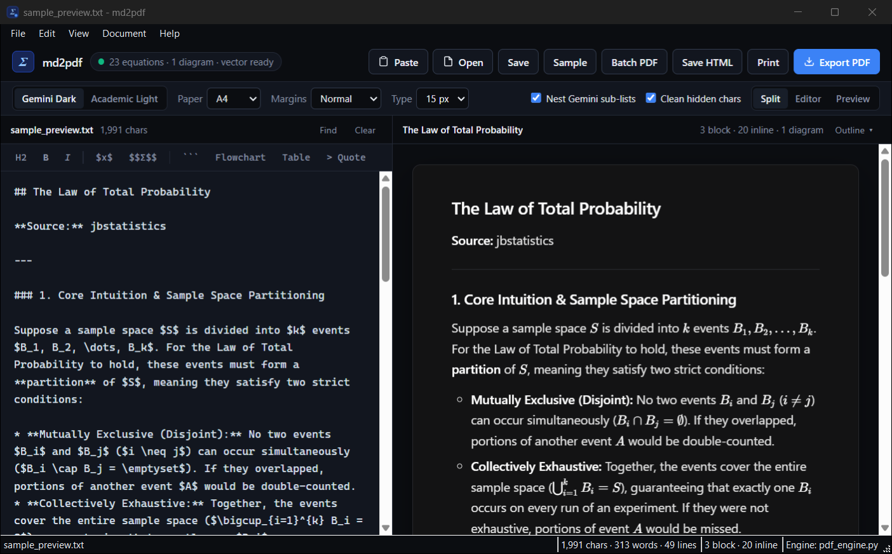
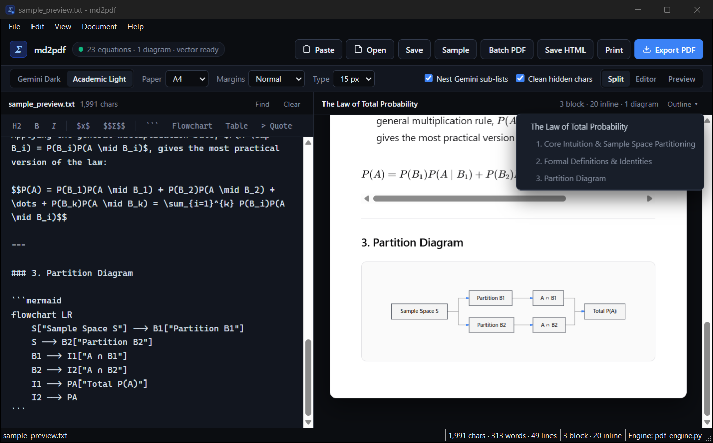

# md2pdf

A native 64-bit Windows desktop application (`md2pdf.exe`) that converts Markdown, LaTeX math, Mermaid diagrams, and copied Gemini responses into crisp vector PDFs—fully offline.

## Screenshots

### Gemini Dark (Split View)


### Academic Light (Display Math, Mermaid Diagram & Document Outline)


## Features

- **Vector Math & Diagrams:** Offline rendering using bundled `marked`, `KaTeX` (with local `.woff2` fonts), and `beautiful-mermaid` SVG diagrams (`vendor/`, `gemini-renderer.js`).
- **Gemini Copy Helpers:** Optional cleanup of hidden padding/zero-width characters and automatic reconstruction of flattened nested sub-lists when pasting copied Gemini responses.
- **Themes & Page Layout:** Switch between `Gemini Dark` and `Academic Light`, `A4` or `Letter` paper, `Compact` / `Normal` / `Academic` margins, and `13–16 px` type sizes, with automatic scaling of wide equations on export.
- **Native Windows Desktop Shell:** Windows 10/11 dark title bar, Per-Monitor DPI awareness, custom `.ico`, persisted window bounds & settings (`settings.json`), native menus, Open/Save dialogs, Recent Files (up to 10 items), drag-and-drop, and Explorer reveal for exported PDFs.
- **Dual PDF Engines** (`Document -> PDF Engine`):
  - **Python Chromium Engine (`pdf_engine.py`)** — Headless Chrome/Edge vector PDF export (with automatic fallback to WebView2 if needed).
  - **Native WebView2 Direct PrintToPdf** — Instant in-process PDF generation via Edge WebView2.
- **Batch PDF Export** (`Ctrl+B`): Convert multiple `.md`/`.txt` files into vector PDFs in one folder using `desktop_backend.py` and `pdf_engine.py`.
- **Editor Productivity Tools:** Split / Editor-Only / Preview-Only layouts (`Ctrl+1` / `Ctrl+2` / `Ctrl+3`), Find & Replace (`Ctrl+F`), Markdown & LaTeX formatting toolbar, Document Outline navigator, standalone HTML export (`Ctrl+Shift+H`), and live file watcher (`View -> Watch Open File for Changes`).

## Requirements

- **Windows 10 / 11 (x64)** with **Microsoft Edge WebView2 Runtime** (pre-installed on Windows 11 and modern Windows 10 systems)
- **Python 3** (standard library only at runtime) + **Google Chrome or Microsoft Edge** (for the `pdf_engine.py` headless Chromium engine and Batch PDF export; single-file export automatically falls back to WebView2 if needed)

## Quick Start

Double-click `md2pdf.exe` or `Launch-md2pdf.bat`, or open a file directly from the command line:

```powershell
.\md2pdf.exe path\to\notes.md
```

## Keyboard Shortcuts

| Shortcut | Action |
| :--- | :--- |
| `Ctrl+N` | New document |
| `Ctrl+O` | Open `.txt` / `.md` file |
| `Ctrl+S` / `Ctrl+Shift+S` | Save / Save As |
| `Ctrl+E` | Export vector PDF |
| `Ctrl+Shift+H` | Export standalone HTML |
| `Ctrl+B` | Batch convert files to PDF |
| `Ctrl+P` | Print |
| `Ctrl+F` | Find & Replace in editor |
| `Ctrl+1` / `Ctrl+2` / `Ctrl+3` | Split / Editor Only / Preview Only |
| `Ctrl++` / `Ctrl+-` / `Ctrl+0` | Zoom In / Out / Reset |
| `F11` | Toggle Full Screen |
| `F12` | Open WebView2 DevTools |

## Sample Outputs

Example PDFs rendered from the same source in both themes are available in [`examples/`](examples/).

## Building from Source & Self-Test

Rebuild `md2pdf.exe` from the repository root using the .NET Framework 4.0 x64 C# compiler (`csc.exe`):

```powershell
powershell -ExecutionPolicy Bypass -File .\build.ps1
```

Run the automated end-to-end self-test (verifies Markdown/KaTeX/Mermaid rendering and both `pdf_engine.py` and WebView2 `PrintToPdfAsync` PDF outputs, writing `selftest_report.json` alongside the output PDF):

```powershell
.\md2pdf.exe --self-test "$env:TEMP\md2pdf_test\out.pdf"
```
